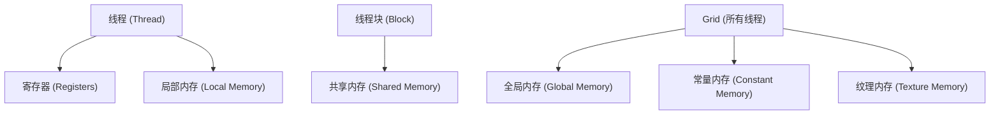
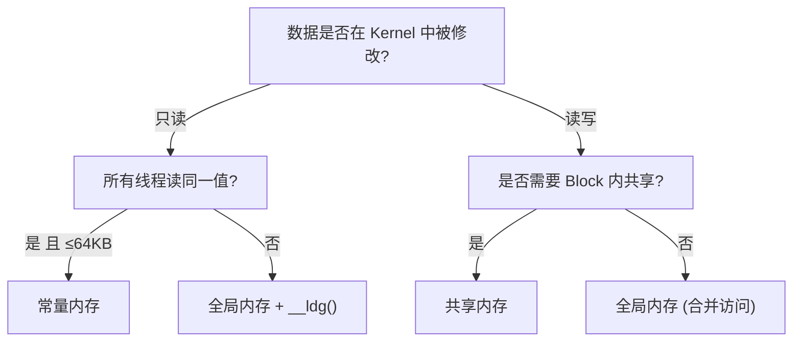
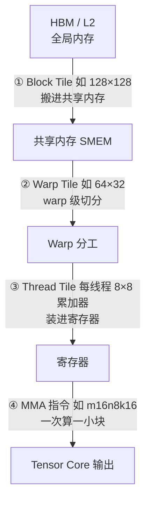

理解 CUDA 的多层内存层次是写出高性能 Kernel 的关键。本文详解全局内存、共享内存、寄存器、常量内存和统一内存的特性、适用场景及优化技巧。

<!-- more -->

## 📑 目录

- [1. 为什么内存模型如此重要](#1-为什么内存模型如此重要)
- [2. 内存层次总览](#2-内存层次总览)
- [3. 全局内存](#3-全局内存)
- [4. 共享内存](#4-共享内存)
- [5. 寄存器与局部内存](#5-寄存器与局部内存)
- [6. 常量内存](#6-常量内存)
- [7. 纹理内存](#7-纹理内存)
- [8. 统一内存](#8-统一内存)
- [9. 内存选型决策指南](#9-内存选型决策指南)
- [总结](#-总结)

---

## 1. 为什么内存模型如此重要

GPU 的计算能力极强——一块 A100 的峰值算力为 312 TFLOPS（FP16，Tensor Core 含稀疏加速），但它的显存带宽只有约 2 TB/s。做一道简单的算术：一次浮点乘加（FMA）需要读 2 个 float（8 Bytes）产生 2 个 FLOP，那么 2 TB/s 带宽最多喂饱 500 GFLOPS 的计算——不到峰值算力的 0.2%。

这意味着：**绝大多数 Kernel 的性能瓶颈不是计算，而是内存访问**。理解 CUDA 的多层内存层次，学会把数据放在"离计算最近的地方"，是优化 GPU 程序的第一课。

---

## 2. 内存层次总览

GPU 的内存层次就像城市的交通系统——寄存器是办公桌上的文件（最快但最小），共享内存是同一办公室的文件柜（快速且可共享），全局内存是城市外的大仓库（容量大但来回需要时间）。

### 2.1 内存层次架构图




### 2.2 各级内存对比

| 📊 内存类型 | 位置 | 容量 | 延迟 | 带宽 | 作用域 | 生命周期 |
|------------|------|------|------|------|--------|---------|
| 寄存器 | SM 芯片上 | ~256KB/SM | 1 cycle | 最高 | 单线程 | 线程生命周期 |
| 共享内存 | SM 芯片上 | 48~228KB/SM（因架构而异） | ~20 cycles | ~19 TB/s | Block 内 | Block 生命周期 |
| L1 Cache | SM 芯片上 | 128~256KB/SM | ~30 cycles | ~19 TB/s | 自动 | 自动管理 |
| L2 Cache | GPU 芯片上 | 6~50MB | ~200 cycles | ~5 TB/s | 所有 SM | 自动管理 |
| 全局内存 (HBM) | 芯片外 | 16~80GB | ~400 cycles | 1~3.4 TB/s | 全局 | 应用生命周期 |
| 常量内存 | 芯片外+缓存 | 64KB | 1~400 cycles | 有缓存时极高 | 全局只读 | 应用生命周期 |

---


## 3. 全局内存

全局内存（Global Memory）是 GPU 的"主存"，对应物理上的 HBM（高带宽内存）。它容量最大但延迟最高，是 CPU-GPU 数据交换的枢纽。

### 3.1 基本操作

```cpp
// 分配设备内存
float* d_data;
size_t size = N * sizeof(float);
cudaMalloc(&d_data, size);

// Host → Device 传输
cudaMemcpy(d_data, h_data, size, cudaMemcpyHostToDevice);

// Device → Host 传输
cudaMemcpy(h_result, d_data, size, cudaMemcpyDeviceToHost);

// 释放设备内存
cudaFree(d_data);
```

### 3.2 合并访问（Coalesced Access）

全局内存的访问效率取决于**一个 Warp 内 32 个线程的访问模式是否连续对齐**。GPU 以 32B/64B/128B 的粒度从全局内存取数据（一次"事务"），如果 Warp 内线程访问的地址连续，一次事务就能满足所有线程——这就是**合并访问**。

```cpp
// ✅ 合并访问：连续线程访问连续地址
// Thread 0 → data[0], Thread 1 → data[1], ...
float val = data[threadIdx.x + blockIdx.x * blockDim.x];

// ❌ 跨步访问：效率低
// Thread 0 → data[0], Thread 1 → data[stride], ...
float val = data[(threadIdx.x + blockIdx.x * blockDim.x) * stride];
```


### 3.3 访问模式对性能的影响

| 访问模式 | 事务数（Warp 访问 32 个 float） | 有效带宽利用率 |
|---------|-------------------------------|--------------|
| 完美合并（连续对齐） | 1 次 128B 事务 | 100% |
| 连续但未对齐 | 2 次 128B 事务 | 50% |
| 随机散列访问 | 最多 32 次 32B 事务 | ~3% |

💡 **提示**：在设计数据结构时，优先选择 **Structure of Arrays (SoA)** 而非 **Array of Structures (AoS\)**，因为 SoA 更容易实现合并访问。

### 3.4 SoA vs AoS 示例

```cpp
// ❌ AoS（Array of Structures）— 相邻线程访问不连续
struct Particle {
    float x, y, z;
    float vx, vy, vz;
};
Particle particles[N];
// Thread i 访问 particles[i].x → 间隔 sizeof(Particle) = 24 bytes

// ✅ SoA（Structure of Arrays）— 相邻线程访问连续
struct Particles {
    float x[N], y[N], z[N];
    float vx[N], vy[N], vz[N];
};
Particles p;
// Thread i 访问 p.x[i] → 间隔 sizeof(float) = 4 bytes，完美合并
```

### 3.5 动手实验：合并访问前后耗时对比

光看表格没有体感，下面用一个最小实验验证跨步访问的代价：三组 Kernel 分别以 stride = 1 / 2 / 32 读取同一块 1 GiB 的 float 数组并求和（工作集远大于 L2，保证每次读都真的落到显存），用 CUDA Event 计时，对比耗时与有效带宽。

> 💻 实验环境：RTX 5060 Laptop GPU（Blackwell，8GB GDDR7，128-bit，理论带宽约 384 GB/s），代码兼容 CUDA 12.x / 13.x（Windows 本机 12.9、WSL 13.x 均可编译）。其他显卡结论方向一致，数值按带宽比例缩放。
>
> ⚠️ 一个容易踩的坑：不要用"同一元素重复读 N 次"来放大访存时间——重复读会命中 L1/L2 缓存，报出来的带宽会虚高到超过显存物理峰值（比如 1500+ GB/s）。判断结果是否可信的黄金标准：**有效带宽不能超过显存理论峰值**。

**实验代码**（保存为 `coalesce_bench.cu`）：

```cpp
#include <cstdio>
#include <cuda_runtime.h>

#define N (256 * 1024 * 1024)  // 256M floats = 1 GiB，远大于 L2（几十 MB），保证读操作穿透到显存

// ✅ 合并访问：warp 内连续线程读连续地址，每个元素只读一次
__global__ void readCoalesced(const float* __restrict__ in, float* out, int n) {
    int gid = blockIdx.x * blockDim.x + threadIdx.x;
    int total = gridDim.x * blockDim.x;
    float s = 0.0f;
    for (int i = gid; i < n; i += total)            // grid-stride loop
        s += in[i];
    if (s == 12345.678f) out[gid] = s;              // 防止死代码消除
}

// ❌ 跨步访问：warp 内线程 i 读 in[i * STRIDE]，每个元素只读一次
template <int STRIDE>
__global__ void readStrided(const float* __restrict__ in, float* out, int n) {
    int gid = blockIdx.x * blockDim.x + threadIdx.x;
    int total = gridDim.x * blockDim.x;
    float s = 0.0f;
    for (int i = gid; i < n / STRIDE; i += total)
        s += in[i * STRIDE];
    if (s == 12345.678f) out[gid] = s;
}

template <typename F>
float bench(F&& launch) {
    cudaEvent_t t0, t1;
    cudaEventCreate(&t0); cudaEventCreate(&t1);
    launch(); cudaDeviceSynchronize();              // 预热

    float best = 1e9f;
    for (int k = 0; k < 5; k++) {                   // 取 5 次最优，避开时钟抖动
        cudaEventRecord(t0);
        launch();
        cudaEventRecord(t1);
        cudaEventSynchronize(t1);
        float ms; cudaEventElapsedTime(&ms, t0, t1);
        if (ms < best) best = ms;
    }
    cudaEventDestroy(t0); cudaEventDestroy(t1);
    return best;
}

int main() {
    cudaDeviceProp prop;
    cudaGetDeviceProperties(&prop, 0);

    // CUDA 13 移除了 prop.memoryClockRate / prop.memoryBusWidth，
    // 改用 cudaDeviceGetAttribute 兼容 12.x / 13.x
    int memClockKHz = 0, busWidthBits = 0;
    cudaDeviceGetAttribute(&memClockKHz, cudaDevAttrMemoryClockRate, 0);
    cudaDeviceGetAttribute(&busWidthBits, cudaDevAttrGlobalMemoryBusWidth, 0);
    // 注意：GDDR6/7 的实际数据率远高于 clock*2，此值仅为粗略参考
    double theoreticalGBps = memClockKHz > 0
        ? memClockKHz * 1e3 * 2.0 * (busWidthBits / 8.0) / 1e9 : 0.0;

    printf("GPU: %s | %d MB | theoretical ~%.0f GB/s\n\n",
           prop.name, (int)(prop.totalGlobalMem >> 20), theoreticalGBps);

    float *d_in, *d_out;
    cudaMalloc(&d_in, N * sizeof(float));
    cudaMalloc(&d_out, 1024 * 256 * sizeof(float));
    cudaMemset(d_in, 0, N * sizeof(float));

    dim3 grid(1024), block(256);

    // 各模式读的"有效字节数"不同：stride=1 读满 1 GiB，stride=2 读 512 MB，stride=32 只读 32 MB
    long long useful1  = (long long)N * 4;
    long long useful2  = (long long)N / 2 * 4;
    long long useful32 = (long long)N / 32 * 4;

    float ms1  = bench([&]{ readCoalesced<<<grid, block>>>(d_in, d_out, N); });
    float ms2  = bench([&]{ readStrided<2><<<grid, block>>>(d_in, d_out, N); });
    float ms32 = bench([&]{ readStrided<32><<<grid, block>>>(d_in, d_out, N); });

    printf("%-12s %10s %14s\n", "模式", "耗时(ms)", "有效带宽");
    printf("%-12s %10.3f %11.1f GB/s\n", "stride=1",  ms1,  useful1  / ms1  / 1e6);
    printf("%-12s %10.3f %11.1f GB/s\n", "stride=2",  ms2,  useful2  / ms2  / 1e6);
    printf("%-12s %10.3f %11.1f GB/s\n", "stride=32", ms32, useful32 / ms32 / 1e6);

    cudaFree(d_in); cudaFree(d_out);
    return 0;
}
```

**实验步骤**：

```bash
# 1. 编译（5060 Laptop 是 Blackwell 架构，需 sm_120，CUDA 12.8+ 才支持）
nvcc -O3 -arch=sm_120 coalesce_bench.cu -o coalesce_bench

# 2. 运行
./coalesce_bench

# 3.（可选）用 Nsight Compute 看事务数，验证 stride=32 时每个 warp 产生 ~32 次事务
ncu --set basic ./coalesce_bench
```

**实测结果**（RTX 5060 Laptop GPU，理论带宽 384 GB/s，2026-11 实测）：

| 访问模式 | 预期事务数/Warp | 理论带宽利用率 | 实测耗时 | 实测带宽 | 实测利用率 |
|---------|----------------|--------------|---------|---------|-----------|
| stride=1（合并） | 1 次 128B | ~100% | 3.097 ms | 346.7 GB/s | 90% |
| stride=2 | 2 次 128B | ~50% | 3.100 ms | 173.2 GB/s | 45% |
| stride=32 | 最多 32 次 32B | ~3% | 0.791 ms | 42.4 GB/s | 11% |

**预期现象**：stride=1 能跑到理论带宽的 80%~95%；stride=2 约为一半（每个 32B 扇区只用一半字节）；stride=32 会掉到 10% 上下——比 3.3 节按 128B 事务算出的 ~3% 好一些，因为 Volta 之后 GPU 按 32B 扇区粒度取数。三者依次拉开的倍数，正是访存模式从"完美合并"滑向"极度浪费"的直观体现。**记得自查：三档有效带宽都不应超过显存理论峰值，否则说明数据被缓存了。**

---

## 4. 共享内存

共享内存（Shared Memory）位于 SM 芯片上，48~228KB/SM（因架构而异），是 Block 内所有线程共享的高速暂存。把它想象成一个团队的白板——团队成员都可以快速读写，但其他团队看不到。

### 4.1 声明与使用
静态声明：

```cpp
__global__ void sharedMemDemo(float* input, float* output, int N) {
    // 静态声明：编译时确定大小
    __shared__ float tile[256];

    int idx = blockIdx.x * blockDim.x + threadIdx.x;
    if (idx < N) {
        // 将全局内存数据加载到共享内存
        tile[threadIdx.x] = input[idx];

        // 同步：确保所有线程都完成加载
        __syncthreads();

        // 现在可以安全地访问 tile 中其他线程加载的数据
        int partner = blockDim.x - 1 - threadIdx.x;
        output[idx] = tile[partner];
    }
}
```
动态声明：

```cpp
// 动态声明：运行时确定大小
__global__ void dynamicSharedMem(float* data, int N) {
    extern __shared__ float sharedData[];  // 大小在启动时指定

    int idx = blockIdx.x * blockDim.x + threadIdx.x;
    if (idx < N) {
        sharedData[threadIdx.x] = data[idx];
    }
    __syncthreads();
    // ...
}

// 启动时通过第三个参数指定动态共享内存大小
int sharedMemSize = blockSize * sizeof(float);
dynamicSharedMem<<<grid, block, sharedMemSize>>>(data, N);
```

### 4.2 Bank Conflict

共享内存被划分为 32 个 **Bank**（对应 32 个 Warp 线程），每个 Bank 宽度为 4 bytes。当一个 Warp 中多个线程同时访问同一个 Bank 的不同地址时，访问必须串行化——这就是 **Bank Conflict**。

```
Bank 编号 = (地址 / 4 bytes) % 32
```

```cpp
// ✅ 无 Bank Conflict：每个线程访问不同 Bank
float val = shared[threadIdx.x];         // 线程 i → Bank i

// ❌ 2-way Bank Conflict：步长为 2，线程 0 和 16 冲突
float val = shared[threadIdx.x * 2];     // 线程 0 → Bank 0, 线程 16 → Bank 0

// ✅ 广播无冲突：所有线程读同一地址
float val = shared[0];                   // 广播，无冲突
```

### 4.3 避免 Bank Conflict 的技巧

对于矩阵转置等场景，经典方法是添加 padding：

```cpp
// 原始：2D 共享内存，列访问时会有 Bank Conflict
__shared__ float tile[32][32];

// 优化：加 1 列 padding，错开 Bank 对齐
__shared__ float tile[32][32 + 1];  // 33 列
```

### 4.4 共享内存配置

现代 GPU（sm\_80+）的 L1 Cache 和共享内存**共享同一块物理 SRAM**，可以通过 API 配置比例：

```cpp
// 优先分配更多共享内存（最大 164KB on A100）
cudaFuncSetAttribute(myKernel,
    cudaFuncAttributeMaxDynamicSharedMemorySize, 164 * 1024);

// 设置 L1/Shared Memory 偏好
cudaFuncSetCacheConfig(myKernel, cudaFuncCachePreferShared);
```

---

## 5. 寄存器与局部内存

### 5.1 寄存器

寄存器是每个线程私有的最快存储。Kernel 中的局部变量默认存放在寄存器中：

```cpp
__global__ void compute(float* data, int N) {
    int idx = blockIdx.x * blockDim.x + threadIdx.x;  // 存在寄存器
    float temp = 0.0f;                                  // 存在寄存器
    float acc = 0.0f;                                   // 存在寄存器

    for (int i = 0; i < 10; i++) {
        temp = data[idx + i * N];
        acc += temp * temp;
    }
    data[idx] = acc;
}
```

### 5.2 寄存器溢出（Register Spilling）

每个 SM 的寄存器总量有限（如 A100 为 65536 个 32-bit 寄存器/SM）。当一个线程使用的寄存器超过 SM 能分配给它的数量时，多出的变量会"溢出"到**局部内存**（实际是全局内存的一块区域，有 L1/L2 缓存加速但延迟仍然高）。

```bash
# 查看 Kernel 的寄存器用量
nvcc --ptxas-options=-v mykernel.cu
# ptxas info: Used 48 registers, 0 bytes smem

# 限制最大寄存器数（可能导致溢出但提高占用率）
nvcc --maxrregcount=32 mykernel.cu
```

### 5.3 寄存器使用建议

| ✅ 推荐做法 | ❌ 不推荐做法 |
|-------------|--------------|
| 复用临时变量 | 声明大量独立变量 |
| 循环展开适度（`#pragma unroll`） | 展开因子过大导致寄存器爆炸 |
| 用 `--ptxas-options=-v` 监控 | 盲目追求零溢出 |

⚠️ **注意**：寄存器使用是一个**权衡**——用更多寄存器可以减少计算中的内存访问，但也会降低 SM 上能同时驻留的 Warp 数量（降低占用率）。需要根据具体 Kernel 找平衡点。

---

## 6. 常量内存

常量内存（Constant Memory）是一块 64KB 的**只读**全局内存区域，配有专用的常量缓存。当 Warp 内所有线程读取同一地址时，一次缓存读取就能广播给 32 个线程。

### 6.1 声明与使用

```cpp
// 在全局作用域声明常量内存
__constant__ float coefficients[256];

// 主机端拷贝数据到常量内存
float h_coeff[256];
// ... 填充 h_coeff ...
cudaMemcpyToSymbol(coefficients, h_coeff, sizeof(h_coeff));

// Kernel 中直接读取（像全局变量一样）
__global__ void applyFilter(float* data, float* output, int N) {
    int idx = blockIdx.x * blockDim.x + threadIdx.x;
    if (idx < N) {
        float result = 0.0f;
        for (int i = 0; i < 256; i++) {
            result += data[idx + i] * coefficients[i];  // 所有线程读同一个 coefficients[i]
        }
        output[idx] = result;
    }
}
```

### 6.2 适用场景

| ✅ 适合常量内存 | ❌ 不适合常量内存 |
|----------------|-----------------|
| 所有线程读相同值（卷积核、系数表） | 每个线程读不同地址 |
| 数据量 ≤ 64KB | 数据量超过 64KB |
| 数据在 Kernel 执行期间不变 | 数据需要被 GPU 修改 |

📌 **关键点**：如果 Warp 内不同线程访问常量内存的不同地址，访问会被串行化为 32 次读取，性能反而比全局内存更差。

---

## 7. 纹理内存

纹理内存（Texture Memory）通过专用的纹理缓存访问全局内存，它针对**二维空间局部性**做了优化。在深度学习时代，纹理内存使用较少，但在图像处理和某些插值场景中仍有价值。

### 7.1 特点

- 针对 2D 空间局部性优化的缓存策略
- 支持硬件插值（线性/双线性）
- 支持自动边界处理（Clamp/Wrap）
- 对不规则访问模式比全局内存表现更好

### 7.2 现代替代

在 CUDA 12+ 中，L1/L2 缓存的优化已经覆盖了大部分纹理内存的使用场景。对于新代码，建议：
- 规则访问模式 → 直接使用全局内存 + L1 缓存
- 只读数据 → 使用 `__ldg()` 内置函数走只读缓存路径
- 需要硬件插值 → 仍然使用纹理

```cpp
// __ldg() 走只读缓存路径，无需配置纹理对象
float val = __ldg(&input[idx]);
```

---

## 8. 统一内存

统一内存（Unified Memory）是 CUDA 6.0 引入的编程抽象——它提供一个**单一地址空间**，CPU 和 GPU 都可以通过相同的指针访问数据，系统自动在两者之间迁移页面。

### 8.1 基本用法

```cpp
// 分配统一内存
float* data;
cudaMallocManaged(&data, N * sizeof(float));

// CPU 端初始化——直接用指针
for (int i = 0; i < N; i++) {
    data[i] = (float)i;
}

// GPU 端计算——同一个指针
myKernel<<<grid, block>>>(data, N);
cudaDeviceSynchronize();

// CPU 端读取结果——还是同一个指针
printf("Result: %f\n", data[0]);

// 释放
cudaFree(data);
```

### 8.2 页面迁移机制

统一内存的"魔法"背后是操作系统级别的**按需页面迁移**：
1. CPU 首次写入时，页面驻留在系统内存
2. GPU Kernel 访问时触发缺页中断，驱动将页面迁移到显存
3. Kernel 执行完后 CPU 再次访问，页面迁回系统内存

### 8.3 性能优化：预取

自动按需迁移有延迟开销，可以通过预取（Prefetch）提前触发迁移：

```cpp
// 在 Kernel 启动前，预取数据到 GPU
int device;
cudaGetDevice(&device);
cudaMemPrefetchAsync(data, N * sizeof(float), device);

myKernel<<<grid, block>>>(data, N);
cudaDeviceSynchronize();

// Kernel 完成后，预取结果到 CPU
cudaMemPrefetchAsync(data, N * sizeof(float), cudaCpuDeviceId);
```

### 8.4 适用场景分析

| ✅ 适合统一内存 | ❌ 不适合统一内存 |
|----------------|-----------------|
| 原型开发和快速迭代 | 极致性能要求的生产代码 |
| CPU/GPU 交替访问的复杂数据结构 | 大块数据的单向传输 |
| 链表、树等指针结构 | 简单的输入→计算→输出模式 |
| 不确定 GPU 会访问哪些数据 | 明确知道数据使用模式 |

⚠️ **注意**：统一内存简化了编程但可能牺牲性能。对于性能敏感的代码，显式使用 `cudaMemcpy` 通常比统一内存快，因为你可以精确控制数据传输时机并与计算重叠。

---

## 9. 内存选型决策指南

面对一个新 Kernel，如何决定把数据放在哪里？



### 9.1 快速参考卡片

| 需求 | 首选方案 | 次选方案 |
|------|---------|---------|
| Block 内线程间数据交换 | 共享内存 + `__syncthreads()` | Warp Shuffle（同 Warp 内） |
| 全局只读广播 | 常量内存 | `__ldg()` |
| 大数组逐元素处理 | 全局内存（合并访问） | — |
| 局部累加器/计数器 | 寄存器 | — |
| 复杂数据结构快速原型 | 统一内存 | — |
| 减少全局内存事务 | Tiling + 共享内存 | L1 缓存 |

### 9.2 典型优化模式：Tiling

Tiling 是最经典的内存优化模式——将全局内存数据分块加载到共享内存，在共享内存上做多次计算，从而用少量全局内存访问换取大量快速的共享内存访问：

```cpp
__global__ void matmulTiled(float* A, float* B, float* C,
                            int M, int N, int K) {
    __shared__ float As[TILE][TILE];
    __shared__ float Bs[TILE][TILE];

    int row = blockIdx.y * TILE + threadIdx.y;
    int col = blockIdx.x * TILE + threadIdx.x;
    float sum = 0.0f;

    for (int t = 0; t < (K + TILE - 1) / TILE; t++) {
        // 协作加载 tile 到共享内存
        if (row < M && t * TILE + threadIdx.x < K)
            As[threadIdx.y][threadIdx.x] = A[row * K + t * TILE + threadIdx.x];
        else
            As[threadIdx.y][threadIdx.x] = 0.0f;

        if (col < N && t * TILE + threadIdx.y < K)
            Bs[threadIdx.y][threadIdx.x] = B[(t * TILE + threadIdx.y) * N + col];
        else
            Bs[threadIdx.y][threadIdx.x] = 0.0f;

        __syncthreads();

        // 在共享内存上计算
        for (int k = 0; k < TILE; k++) {
            sum += As[threadIdx.y][k] * Bs[k][threadIdx.x];
        }
        __syncthreads();
    }

    if (row < M && col < N) {
        C[row * N + col] = sum;
    }
}
```

💡 **提示**：Tiling 的核心思想——"搬一次数据，用多次"——在 FlashAttention、GEMM 优化等高级场景中反复出现，是 GPU 编程最重要的优化范式之一。

### 9.3 动手实验：Naive vs Tiling 矩阵乘法对比

上面这个 `matmulTiled` 到底值多少钱？用 2048×2048 单精度矩阵乘（约 17 GFLOP）实测：Naive 版让 B 矩阵按列访问（warp 内相邻线程地址差 n×4B，天然大 stride，正好复用 3.5 节的结论），Tiled 版走 9.2 的分块路径，对比耗时与 GFLOPS。

> ⚠️ **WSL 实测踩坑**：本实验第一版用 `cudaMallocManaged` 分配全部数据，在 WSL 上 GPU 侧访问统一内存的性能劣化严重（Naive 只有 6.2 GFLOPS、Tiled 13.2，比正常水平低约两个数量级）。已改用 `cudaMalloc` + `cudaMemcpy` 显式传输——正是 8.4 节"性能敏感场景用显式传输"的活例子。原生 Linux 上 UM 迁移后性能接近显存，但 benchmark 求稳一律用显式管理。

**实验代码**（保存为 `tile_bench.cu`）：

```cpp
#include <cstdio>
#include <cmath>
#include <cuda_runtime.h>

#define N 2048      // A+B+C 共 48MB，超出 L2（几十MB），DRAM 流量真实

// ❌ Naive：C = A×B，B 按列访问 → warp 内大 stride
__global__ void matmulNaive(const float* __restrict__ A, const float* __restrict__ B,
                            float* C, int n) {
    int row = blockIdx.y * blockDim.y + threadIdx.y;
    int col = blockIdx.x * blockDim.x + threadIdx.x;
    if (row < n && col < n) {
        float s = 0.0f;
        for (int k = 0; k < n; k++)
            s += A[row * n + k] * B[k * n + col];   // A 合并，B 按列：相邻线程差 n*4B
        C[row * n + col] = s;
    }
}

// ✅ Tiled：分块加载到共享内存，块内复用 + 合并访问（TILE 做成模板参数，方便扫描 8/16/32）
template <int TILE>
__global__ void matmulTiled(const float* __restrict__ A, const float* __restrict__ B,
                            float* C, int n) {
    __shared__ float As[TILE][TILE];
    __shared__ float Bs[TILE][TILE];

    int row = blockIdx.y * TILE + threadIdx.y;
    int col = blockIdx.x * TILE + threadIdx.x;
    float s = 0.0f;

    for (int t = 0; t < n / TILE; t++) {
        // 协作加载：warp 内相邻线程读连续地址（合并访问）
        As[threadIdx.y][threadIdx.x] = A[row * n + t * TILE + threadIdx.x];
        Bs[threadIdx.y][threadIdx.x] = B[(t * TILE + threadIdx.y) * n + col];
        __syncthreads();

        #pragma unroll
        for (int k = 0; k < TILE; k++)
            s += As[threadIdx.y][k] * Bs[k][threadIdx.x];  // 每个数据被 Block 内 32 线程复用
        __syncthreads();
    }
    C[row * n + col] = s;
}

template <typename F>
float bench(F&& launch) {
    cudaEvent_t t0, t1;
    cudaEventCreate(&t0); cudaEventCreate(&t1);
    launch(); cudaDeviceSynchronize();              // 预热

    float best = 1e9f;
    for (int k = 0; k < 5; k++) {                   // 取 5 次最优，避开时钟抖动
        cudaEventRecord(t0);
        launch();
        cudaEventRecord(t1);
        cudaEventSynchronize(t1);
        float ms; cudaEventElapsedTime(&ms, t0, t1);
        if (ms < best) best = ms;
    }
    cudaEventDestroy(t0); cudaEventDestroy(t1);
    return best;
}

int main() {
    size_t bytes = (size_t)N * N * sizeof(float);
    float *h_A = (float*)malloc(bytes), *h_B = (float*)malloc(bytes);
    float *d_A, *d_B, *d_C1, *d_C2;
    cudaMalloc(&d_A, bytes); cudaMalloc(&d_B, bytes);
    cudaMalloc(&d_C1, bytes); cudaMalloc(&d_C2, bytes);

    for (size_t i = 0; i < (size_t)N * N; i++) {    // 取值小，控制浮点累加误差
        h_A[i] = (i % 7) * 0.01f;
        h_B[i] = ((i / 13) % 5) * 0.01f;
    }
    cudaMemcpy(d_A, h_A, bytes, cudaMemcpyHostToDevice);
    cudaMemcpy(d_B, h_B, bytes, cudaMemcpyHostToDevice);

    dim3 blockN(16, 16), gridN(N / 16, N / 16);

    float msNaive = bench([&]{ matmulNaive<<<gridN, blockN>>>(d_A, d_B, d_C1, N); });
    // TILE 扫描：8 / 16 / 32（最后一次写 C2，用于正确性比对）
    float ms8  = bench([&]{ matmulTiled<8> <<<dim3(N / 8,  N / 8),  dim3(8,  8) >>>(d_A, d_B, d_C2, N); });
    float ms16 = bench([&]{ matmulTiled<16><<<dim3(N / 16, N / 16), dim3(16, 16)>>>(d_A, d_B, d_C2, N); });
    float ms32 = bench([&]{ matmulTiled<32><<<dim3(N / 32, N / 32), dim3(32, 32)>>>(d_A, d_B, d_C2, N); });

    double gflop = 2.0 * N * N * N / 1e9;
    printf("N=%d (%.1f GFLOP/次)\n\n", N, gflop);
    printf("%-10s %12s %16s %14s\n", "版本", "耗时(ms)", "性能", "vs Naive");
    printf("%-10s %12.2f %13.1f GFLOPS %9.2fx\n", "Naive",   msNaive, gflop / msNaive * 1e3, 1.0);
    printf("%-10s %12.2f %13.1f GFLOPS %9.2fx\n", "Tile=8",  ms8,     gflop / ms8     * 1e3, msNaive / ms8);
    printf("%-10s %12.2f %13.1f GFLOPS %9.2fx\n", "Tile=16", ms16,    gflop / ms16    * 1e3, msNaive / ms16);
    printf("%-10s %12.2f %13.1f GFLOPS %9.2fx\n", "Tile=32", ms32,    gflop / ms32    * 1e3, msNaive / ms32);

    // 正确性校验：拷回 CPU 逐元素比对（两个 kernel 累加顺序相同，理论上应逐位一致）
    float *h_C1 = (float*)malloc(bytes), *h_C2 = (float*)malloc(bytes);
    cudaMemcpy(h_C1, d_C1, bytes, cudaMemcpyDeviceToHost);
    cudaMemcpy(h_C2, d_C2, bytes, cudaMemcpyDeviceToHost);
    double maxDiff = 0.0;
    for (size_t i = 0; i < (size_t)N * N; i++) {
        double d = fabs((double)h_C1[i] - h_C2[i]);
        if (d > maxDiff) maxDiff = d;
    }
    printf("正确性: max|C1-C2| = %.6f %s\n", maxDiff, maxDiff < 0.01 ? "(PASS)" : "(FAIL!)");

    free(h_A); free(h_B); free(h_C1); free(h_C2);
    cudaFree(d_A); cudaFree(d_B); cudaFree(d_C1); cudaFree(d_C2);
    return 0;
}
```

**实验步骤**：

```bash
# 1. 编译（同 3.5 节，Blackwell 需 sm_120）
nvcc -O3 -arch=sm_120 tile_bench.cu -o tile_bench

# 2. 运行
./tile_bench

# 3.（可选）用 Nsight Compute 对比两个 Kernel 的指标：
#    重点看 Shared Memory 吞吐、DRAM 吞吐、以及 warp stall 原因
ncu --set full ./tile_bench
```

**实测结果**（RTX 5060 Laptop GPU，FP32 峰值约 13.3 TFLOPS，2026-11 实测）：

| 版本 | 实测耗时 | 实测 GFLOPS | 相对 Naive 加速比 | 峰值占比 |
|------|---------|------------|------------------|---------|
| Naive | 15.17 ms | 1132.7 | 1× | 8.5% |
| Tiled (TILE=8) | 15.30 ms | 1122.9 | 0.99× | 8.4% |
| Tiled (TILE=16) | 11.27 ms | 1523.9 | 1.35× | 11.5% |
| Tiled (TILE=32) | 11.61 ms | 1479.5 | 1.31× | 11.1% |

**实测解读**：

- **Naive 并不惨，Tile=8 也完全不比 Naive 快**（两者都 ~1130 GFLOPS，8.5% 峰值）：16×16 线程块下 warp 覆盖 16 列，B 的"按列访问"在 warp 内其实是连续地址，加上现代 GPU 的 L1/L2 足够大——**Naive 本身就在被 L1 隐式"分块"**。TILE=8 的 tile 太小（每块数据只复用 8 次），复用模式和 Naive 几乎一样，两版撞的是同一个瓶颈。老教材"naive matmul 惨案"在现代缓存面前已不成立。
- **TILE≥16 立刻饱和在共享内存带宽上限**：内层每个 FMA 要 2 次 SMEM 读，32 bank 吞吐把 FMA 封顶在峰值的 ~12.5% ≈ 1.66 TFLOPS；实测 1.48~1.52 TFLOPS 已贴着这个上限的 ~90%。数据搬进了快仓库，但取货窗口有限。
- **有意思的细节：Tile=16 反超 Tile=32**（1523.9 vs 1479.5）：TILE=32 的 1024 线程块每 SM 只能驻留 2 块，调度弹性差；TILE=16 的 256 线程块能驻留 8 块，延迟隐藏更从容。差距不大但有解释力——**tile 不是越大越好，占用率与分块大小要一起权衡**。
- **突破方向**：本实验的天花板由第 ③ 层（Thread Tile，见 9.4 节）打破——寄存器分块把每 FMA 的 SMEM 读从 2 次摊薄到 ~1 次，再叠加 double buffering、Tensor Core。Tiling 只解决"喂得饱"，不解决"算得满"。

### 9.4 现代分层分块：cuBLAS/CUTLASS 的四层金字塔

本实验的单层 TILE 分块只是现代 GEMM 的最外层。真实的高性能矩阵乘（cuBLAS、CUTLASS、FlashAttention）把"分块"做成四层金字塔，每层对应一级存储、解决一个瓶颈：



| 层级 | 典型尺寸 | 数据落在哪 | 解决的瓶颈 | 对应本实验 |
|------|---------|-----------|-----------|-----------|
| ① Block Tile | 128×128 | 全局内存 → 共享内存 | DRAM 带宽 | ✅ 实验的 TILE |
| ② Warp Tile | 64×32 | SMEM → warp 分工 | warp 调度 / 占用率 | ❌ 未做 |
| ③ Thread Tile | 每线程 8×8 累加器 | SMEM → 寄存器 | **共享内存带宽**（就是卡住 Tile=32 的那堵墙） | ❌ 未做 |
| ④ MMA 指令 | m16n8k16 等 | 寄存器 → Tensor Core | CUDA Core 的 FP32 算力上限 | ❌ 未做 |

核心思想一句话：**数据每往内层走一次，就被复用更多次**。A 的一个元素从 HBM 出发，在 L2 被相邻 block 复用、在 SMEM 被块内上百个线程复用、在寄存器被多次 FMA 复用——逐层把"一次搬运"的成本摊薄到成百上千次计算上。

本实验卡在 1.48 TFLOPS 的那堵墙（每 FMA 要 2 次共享内存读），正是第 ③ 层要解决的：让每个线程持有自己的寄存器累加小块，一次 SMEM 读喂多次 FMA。同一块 5060 Laptop 上，cuBLAS 的 SGEMM 能跑到 CUDA Core 峰值的 60%~85%，差距全部来自这套分层调度，而不是硬件本身。

两个配套机制：

- **Double buffering（软件流水线）**：SMEM 准备双份 tile 缓冲，一份正在算、另一份正在从全局内存加载，访存与计算重叠。CUDA 11+ 的 `cp.async` 异步拷贝、Hopper 的 TMA 都是为把这一层做成硬件能力
- **SMEM swizzle**：对共享内存地址做异或重排，让 MMA 指令的多线程读取天然错开 bank，消除冲突

📌 **学习建议**：把 CUTLASS 的 GEMM tutorial 系列（0x 开头那组）当"分层分块的标准答案"对照着读——它每加深一层，就回头看本节表格里它解决了哪个瓶颈，比直接啃源码高效得多。

---

## 📝 总结

CUDA 内存模型的核心认知：

1. **算力远大于带宽**：内存访问是大多数 Kernel 的性能瓶颈
2. **层次化设计**：越靠近计算单元的存储越快、越小
3. **合并访问**：全局内存的首要优化原则——连续线程访问连续地址
4. **共享内存**：Block 内协作的高速中转站，注意 Bank Conflict
5. **Tiling**：最通用的优化范式——分块加载、本地计算、减少全局访问
6. **寄存器**：单线程最快存储，但有限，需权衡占用率
7. **统一内存**：编程简便但性能次优，适合原型和复杂数据结构

## 🎯 自我检验清单

- 能列出 CUDA 五种主要内存类型及其容量、延迟、作用域
- 能解释合并访问的条件，并判断给定访问模式是否合并
- 能将一个 AoS 数据结构改造为 SoA 以实现合并访问
- 能正确使用 `__shared__` 声明共享内存并配合 `__syncthreads()`
- 能识别 Bank Conflict 的成因并使用 padding 解决
- 能用 Tiling 模式优化矩阵乘法 Kernel
- 能根据场景选择正确的内存类型（常量/共享/全局/统一）
- 能使用 `cudaMemPrefetchAsync` 优化统一内存的性能

## 📚 参考资料

- [NVIDIA CUDA C++ Programming Guide - Memory Hierarchy](https://docs.nvidia.com/cuda/cuda-c-programming-guide/index.html#memory-hierarchy)
- [CUDA C++ Best Practices Guide - Memory Optimizations](https://docs.nvidia.com/cuda/cuda-c-best-practices-guide/index.html#memory-optimizations)
- [An Even Easier Introduction to CUDA (NVIDIA Blog)](https://developer.nvidia.com/blog/even-easier-introduction-cuda/)
- [Unified Memory in CUDA 6](https://developer.nvidia.com/blog/unified-memory-in-cuda-6/)
